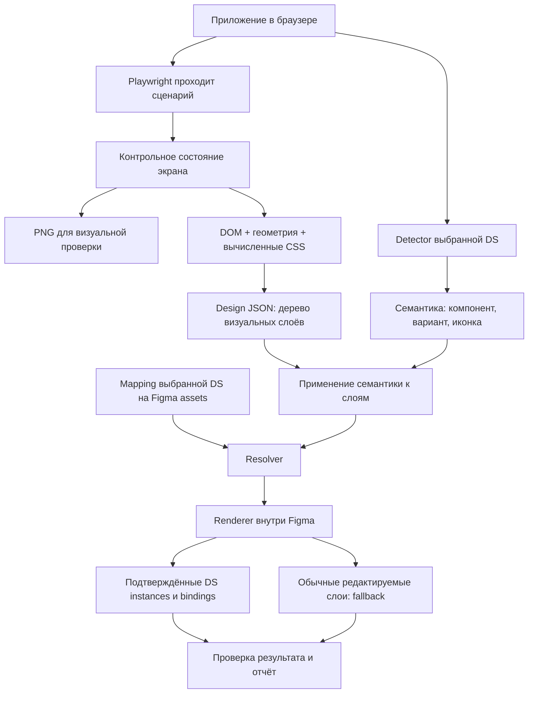
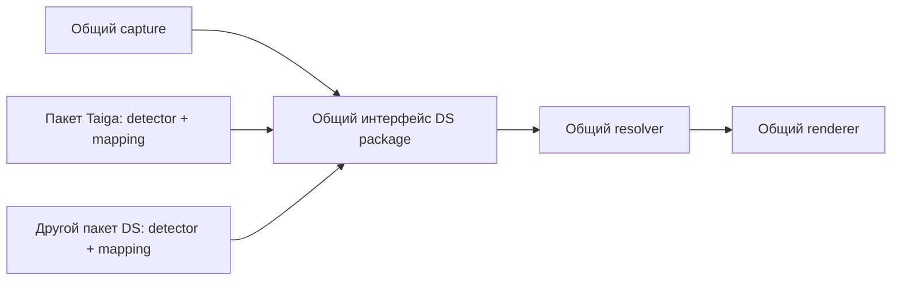
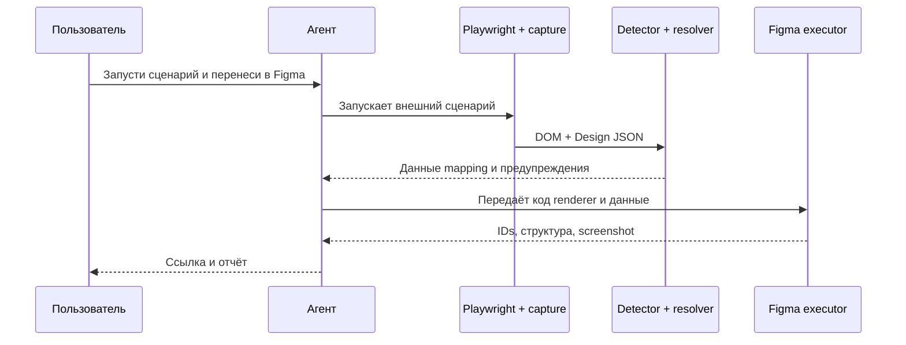

# Playwright → Figma: как всё устроено сейчас

Дата среза: 24 ноября 2026. Это описание фактического состояния PoC, а не обещание готовой системы. Документ нужен для обсуждения следующего роадмапа. В рамках его подготовки код не очищался и не перерабатывался.

## 1. Что мы хотим получить

Запускать E2E-сценарии приложения, сохранять важные состояния экрана и переносить их в Figma как редактируемые макеты. Там, где соответствие подтверждено, использовать компоненты, иконки и токены дизайн-системы. В остальных случаях воспроизводить визуальные параметры обычными слоями.

Ключевые требования:

- Приложение не должно содержать специальные модули, зависимости или атрибуты для нашего инструмента.
- Capture и renderer должны работать с разными дизайн-системами.
- Правила распознавания конкретной DS и её Figma mapping должны поставляться заменяемым пакетом.
- В Figma переносится визуальная статика, а не поведение Angular-компонентов.
- Неоднозначное соответствие означает fallback, а не случайный компонент.
- Исходная секция Figma служит только для ручного сравнения; результат располагается рядом.

## 2. Общая схема E2E



PNG не превращается в редактируемый макет. Он служит отдельным визуальным свидетельством состояния браузера. Источник редактируемого макета — Design JSON.

## 3. Какие репозитории участвуют

| Место | Роль | Состояние |
| --- | --- | --- |
| `playwright-to-figma` | Общий инструмент, capture, resolver, renderer, пакет Taiga и тесты | Рабочие изменения не закоммичены; есть новые untracked файлы |
| `nitro-3-design-prototypes2`, ветка `release-process` | Реальное приложение и исходный E2E-сценарий | На момент проверки рабочее дерево чистое |
| Figma Nitro | Получатель редактируемого результата | Создан отдельный preview рядом с исходной секцией |
| Витрина Taiga UI | Источник для изучения реальных компонентов и токенов | Доступ подтверждён через локальную сеть; полноценный обход витрины ещё не выполнен |

Временные изменения, которые ранее вносились в `release-process` для подключения capture, удалены. Последний запуск сделан внешним сценарием из репозитория инструмента.

## 4. Что происходит на каждом шаге

### Шаг 1. Выполнить пользовательский сценарий

Playwright открывает настоящее приложение, нажимает кнопки, вводит описание и проверяет ожидаемые состояния. Эти действия и проверки не требуют ИИ.

В исходном приложении уже есть `tests/browser/figma-scenarios.spec.ts` и сценарий `edit draft information flow`. Он использует локальный `FlowExport`, который сохраняет PNG и описание переходов, но не DOM.

Для последнего эксперимента создан внешний `tests/real-taiga.spec.ts`. Он повторяет действия исходного сценария и вызывает capture в пяти точках. Это позволяет не менять приложение, но создаёт дублирование сценария. Универсального подключения к произвольному существующему тесту пока нет.

### Шаг 2. Снять визуальную структуру экрана

`capturePageDesign(page)` подключается к Chromium через CDP — протокол инструментов разработчика. Он собирает сведения, которые трудно получить одним чтением DOM: геометрию текста в контролах, псевдоэлементы, фактически использованные шрифты.

Затем `captureDesign(observations)` выполняется в браузере и строит слои: frame, text, svg. Для них сохраняются координаты, размеры, заливки, границы, радиусы, текст и типографика. Слои связываются через `key` и `parent`.

Это снимок конкретного состояния, а не восстановление Angular-кода или адаптивной модели компонента. Некоторые возможности браузерного рендера не поддерживаются; capture должен сообщать о них через diagnostics.

### Шаг 3. Распознать DS по существующей разметке

Пакет Taiga запускает `detect(rules)` в браузере. Он читает существующие селекторы, атрибуты и теги, ничего не добавляя в DOM.

Пример результата:

```text
DOM-элемент
  → компонент tuiButton
  → size=s
  → appearance=primary
```

`applyDesignSystemPackage(page, design, dsPackage)` соединяет результат detector со слоями capture по DOM source path. Сейчас семантика добавляется только к frame-слоям элементов; текстовые и SVG-слои автоматически не получают её.

В пакете генерируется 219 selector rules из установленного каталога. Это не означает 219 проверенных соответствий. Большинство правил распознаёт только тип компонента; варианты и контент для них ещё не разобраны. Неподдерживаемые CSS-селекторы пропускаются без полноценного отчёта.

### Шаг 4. Найти соответствие Figma

`resolveDesignSystem(design, profile)` — чистая функция. Она не обращается к браузеру или Figma. Получает семантику слоя и ищет asset в профиле.

```text
tuiButton + size=s + appearance=primary
  → Figma component set key
  → size=small + appearance=primary
```

Если соответствие отсутствует или значение свойства неизвестно, resolver записывает предупреждение. Такой элемент должен рендериться через native fallback.

Важно: найденный asset key доказывает только наличие записи в каталоге. Он ещё не доказывает правильную границу компонента, актуальный набор вариантов, перенос текста или визуальное совпадение.

### Шаг 5. Создать слои в Figma

`renderDesign(...)` получает Design JSON, resolved mapping и ID пустого контейнера. Он выполняется внутри подключённого Figma-инструмента с доступом к `figma` и `$fig`.

- Frame/text/svg создаются из визуальных параметров capture.
- Подтверждённый component mapping может создавать instance по library key.
- Token/text-style mappings могут передаваться через `$fig.getVar()` и `$fig.getStyle()`.
- Для обновления renderer принимает `previous` — сохранённую карту слоёв и Figma IDs.

Размещение по координатам здесь осмысленно: мы воспроизводим уже измеренный статический экран. Это не автоматическое восстановление исходного CSS flex/grid.

### Шаг 6. Проверить и сохранить результат

Проверяем структуру, DS instances, текст, геометрию и скриншот результата. Для этой задачи пользователь сравнивает результат с соседней исходной секцией вручную.

В проекте есть отдельная инфраструктура pixel comparison и публикационных baseline. Она сравнивает браузерный PNG с экспортом нового рендера, а не с пользовательской исходной секцией. Последний DS preview не проходил полную такую сертификацию и не должен называться fidelity-verified публикацией.

## 5. Основные модули и функции

| Файл | Основной API | Зачем нужен |
| --- | --- | --- |
| `assets/design-capture.ts` | `captureDesign()` | Браузерный DOM → визуальные слои |
| `assets/page-design.ts` | `capturePageDesign(page)` | Дополняет capture данными Chromium/CDP |
| `assets/flow-export.ts` | `FlowExport` | PNG, состояния, переходы; опционально Design JSON |
| `assets/design-system-adapter.mjs` | `applyDesignSystemPackage()` | Применяет detector выбранного DS пакета к capture |
| `assets/design-system-mapping.mjs` | `resolveDesignSystem()` | Семантика → Figma assets и props; предупреждения |
| `assets/design-renderer.mjs` | `renderDesign()` | Создание/обновление редактируемого Figma дерева |
| `profiles/proprietary-taiga-ui-angular/package.mjs` | `detect()`, default package | Taiga detector + загрузка каталога и mapping |
| `scripts/catalog_taiga.py` | `catalog()` | Каталог из установленных npm-пакетов Taiga |
| `scripts/build_taiga_profile.py` | `build()` | Объединяет каталог, overrides и Figma snapshots |
| `scripts/report_taiga_mapping.mjs` | Скрипт отчёта | Человекочитаемая сводка каталожных соответствий |
| `scripts/publication.py` | `inspect`, `record` | Сравнение экспорта с baseline и учёт публикации |
| `scripts/compare_render.py` | `compare()` | Pixel comparison браузерного PNG и Figma render |

Методы `FlowExport`:

- `capture(label, id)` — первый checkpoint.
- `transition(...)` — границы trigger, действие, проверка результата, следующий checkpoint.
- `finish()` — завершение и attachment manifest.
- Внутренние `screenshot()` и `persist()` — сохранение PNG/Design JSON и manifest.

В последнем внешнем эксперименте используется собственная capture-функция внутри `real-taiga.spec.ts`, а не общий `FlowExport`. Поэтому его `{design, mapping}` JSON — экспериментальный формат и не полностью оформленный flow manifest с переходами.

## 6. Как должен отделяться пакет дизайн-системы



Текущий минимальный контракт: `version`, `id`, `detect`, `rules`, `profile`.

Идея замены DS уже отражена в коде. Физическая упаковка пока незавершена: `package.mjs` читает JSON из родительского каталога. Копирование только папки `profiles/proprietary-taiga-ui-angular/` недостаточно — нужны также соседние profile и catalog JSON. Это ещё не автономный npm-пакет.

Компонентно-специфичные правила и перевод вариантов должны оставаться в DS пакете. Общий renderer не должен содержать знания о `tuiButton`, именах его свойств или Nitro.

## 7. Компоненты, иконки, токены и типографика — разные задачи

| Объект | Что нужно распознать | Что пока есть |
| --- | --- | --- |
| Компонент | Тип, граница DOM-поддерева, варианты, контент | Selector rules; подробно разобраны лишь отдельные button props |
| Иконка | Идентичность SVG/имя и размер | Чтение `tui-icon[icon]`; resolver умеет искать asset; общий renderer пока не превращает `resolved.icon` в instance |
| Цветовой токен | Происхождение CSS-значения, а не только RGB | Каталог и resolver есть; runtime provenance detector не реализован |
| Типографика | Стиль, font family/weight и применимость к текстовому слою | Capture литералов и поддержка style handle в renderer; автоматическое распознавание и реальная проверка DS text styles не закончены |

Браузерный `getComputedStyle()` часто возвращает RGB вместо имени CSS-переменной. Чтобы сохранить семантический токен, нужно прослеживать CSS-правило и цепочку `var(...)`. Одинаковый RGB недостаточен для надёжного выбора токена.

Figma text style хранит настройки шрифта, но не поставляет сам шрифт. В нашем запуске Figma отклонила изменение текста button instance из-за unavailable font. Применение опубликованных text styles к native тексту отдельно ещё не проверено — нельзя считать этот путь заведомо неработающим.

## 8. Что реально опубликовано последним запуском

Источник: Nitro, ветка `release-process`; сценарий изменения описания черновика. Внешний Playwright-прогон пяти состояний прошёл.

Результат: [Figma section 5586:10342](https://www.figma.com/design/9rSv6YhxjqOu0owzZA8HaY/Nitro-3.0?node-id=5586-10342), справа от исходной секции `5564:5511`.

В каждом состоянии — один проверенный button instance «Зарелизить». Всего 5 instances. Остальные элементы — обычные редактируемые слои и векторы. Token bindings в этом preview отсутствуют.

Текст внутри library instance изменить не удалось из-за шрифта. В preview скрыт library label и рядом поверх instance помещён отдельный редактируемый label. Основной текст заменён на Roboto, отдельный button label — Inter. Это обход для демонстрации, а не завершённый перенос типографики.

Предварительные числа 20–36 mapped candidates на состояние не являются числом успешных DS instances. После проверки использовано только одно подтверждённое соответствие на состояние.

Артефакты: `artifacts/real-taiga-export/`. Подробности конкретной публикации — `mapping-report.md` в этой папке.

## 9. Где остался временный или проблемный код

| Место | Что осталось | Почему требует внимания |
| --- | --- | --- |
| `tests/real-taiga.spec.ts` | Внешняя копия реального сценария, абсолютный путь в dynamic import через `new Function` | Локальная обвязка PoC, непереносима и дублирует оригинальный тест |
| `tests/real-taiga.config.ts` | Абсолютный путь к Nitro, порт 4400, Chrome channel | Машинно-зависимая конфигурация; файл подходит под общий `*.spec.ts` запуск через соседний тест |
| `artifacts/` | DOM, тексты, PNG, mapping, результаты запусков | Generated данные сейчас untracked и не исключены целиком из git; не должны случайно попасть в общий дистрибутив |
| `tests/design-system-renderer.integration.test.mjs` | Синтетическая кнопка и fake Figma builder | Проверяет локальную логику, но название про соседнюю секцию переоценивает проверку: реального размещения в Figma там нет |
| `profiles/.../package.mjs` | Автогенерация правил из selector catalog | Большое количество правил без проверки вариантов; ошибки CSS selectors проглатываются |
| `profiles/*.json` | Каталожные соответствия и starter overrides | Не все entries проверены визуально; найдены устаревшие/несовпадающие button appearance values |
| `assets/design-capture.ts` | Поддержка специальных `data-figma-*` / `data-tui-*` атрибутов | Может остаться опцией совместимости, но не должна быть обязательна для реального приложения |
| `references/native-design.md` | Инструкция копировать capture/helper в host project | Не соответствует принятому требованию внешнего инструмента; должна быть пересмотрена |
| Публикационный скрипт в чате | Фильтрация mappings, переименование ключей, font workaround, transport encoding | Не сохранён как воспроизводимая команда/модуль; повторить весь E2E одной командой сейчас нельзя |

Не все untracked файлы — мусор: среди них полезные модули, профили и тесты. Их нужно разобрать и оформить, а не удалять общей командой.

## 10. Что обнаружено в общем renderer

Ниже — конкретные ограничения, видимые из кода и последней публикации; это не полный code review.

- Ветка DS instance применяет к instance также native frame props. Это может перезаписать DS fills, strokes, radii и layout. В скрипте последней публикации setter был временно ограничен геометрией; в общем файле исправление не закреплено.
- `mappedChildren` учитывает вложенные mapped components, но не полностью исключает все native descendants заменённого компонента. Для preview поддерево было отфильтровано снаружи. Универсальная обработка границ требует исправления.
- Перенос label, icon slots, boolean properties и контента компонента не оформлен общим контрактом. Для button label использован ручной обход.
- `resolved.icon` пока не используется для создания icon instance.
- Для text styles нужен отдельный путь семантики на text layers: нынешний adapter добавляет semantic только frame-элементам.
- `nativeFallbacks` в renderer считает узкий случай: resolved component при отсутствии builder.instance. Значение 0 не означает отсутствие обычных fallback слоёв.
- Надёжный refresh DS instances отдельно не подтверждён. В проверке previous встречаются разные понятия `instance` и исходного layer kind; существующие тесты не доказывают корректность полного DS refresh.

## 11. Роль ИИ и воспроизводимость



Capture, detector, resolver и логика renderer — обычный детерминированный код. ИИ не должен принимать решения на каждом слое во время штатного запуска.

Но фактическая публикация сейчас агентская: агент вызывает Figma integration, переносит payload и применяет ручные исправления. Нет отдельного автономного executor с транспортом, авторизацией, журналом и одной E2E-командой. Поэтому утверждать, что ИИ уже нужен только для нажатия «старт», пока нельзя.

Плагин не является обязательным следующим шагом. Сначала нужно стабилизировать контракт пакета, capture, renderer и воспроизводимый запуск. Способ отдельной доставки executor можно выбрать позже.

## 12. Что доказано тестами, а что нет

- Реальный исходный сценарий приложения проходил.
- Последний внешний сценарий с capture и detector также прошёл: пять checkpoint exports получены.
- Локальные unit/integration проверки resolver и renderer проходили; они используют fake builder и не подтверждают импорт настоящих Figma assets.
- Изображение state-3 после публикации просмотрено; полный pixel comparison пяти состояний не выполнялся.
- Общий `npm test` ранее упирался в отсутствующий bundled Chromium. Реальный эксперимент запущен через установленный Chrome.
- После добавления локальной внешней обвязки полный набор проверок не перепроверен. Нельзя переносить прежний статус «всё зелёное» на текущий worktree.

## 13. Основа для будущего роадмапа

Роадмап ещё не утверждён. Из этого среза можно отдельно обсудить следующие направления:

1. Очистка PoC: generated artifacts, абсолютные пути, дублирование сценария, противоречивая документация.
2. Воспроизводимый внешний запуск без изменения приложения.
3. Автономный DS пакет: detector, mappings, schema/version, provenance и отчёт покрытия в одном переносимом каталоге.
4. Корректные component boundaries, варианты и content bindings в renderer.
5. Проверка typography styles и доступности шрифтов.
6. Распознавание и перенос icon instances и CSS token provenance.
7. Проверка fidelity и безопасный повторный refresh с сохранением node IDs.
8. Единый отчёт, различающий detected candidate, resolved asset, verified mapping и реально созданный instance/binding.

Главный текущий результат — подтверждён внешний DOM-capture без изменений приложения и создан первый preview с настоящим library instance. Главный незакрытый участок — универсальное и воспроизводимое применение DS, а не получение DOM.
